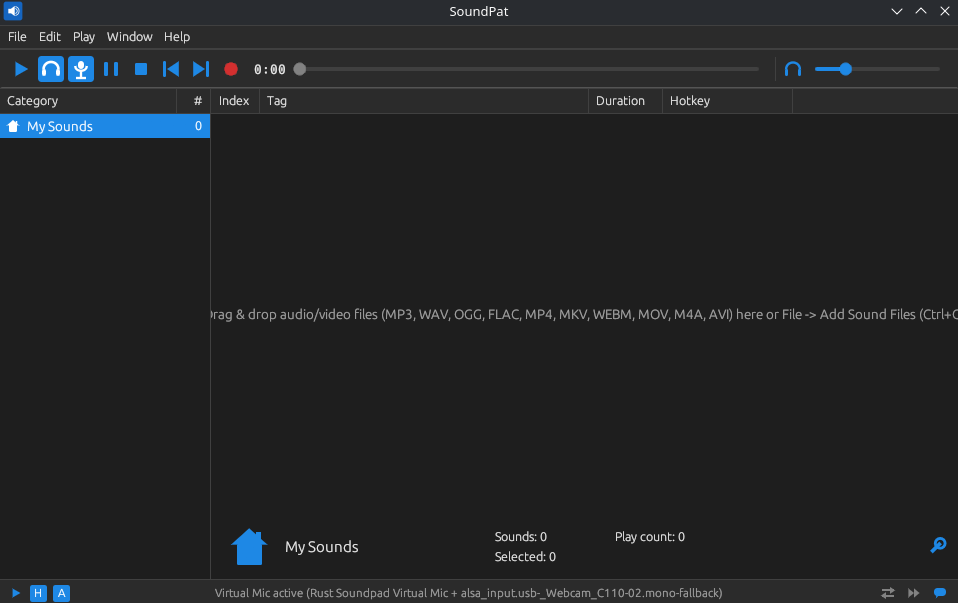

<div align="center">
  
  <h1>SoundPat</h1>
  <p>
    <strong>A fast, native Linux soundboard for PipeWire and Wayland, written in Rust.</strong>
  </p>
  <p>
    Built with <code>eframe</code> / <code>egui</code> in the spirit of classic Soundpad — featuring a virtual microphone mixer, native Wayland global hotkeys, built-in audio recording, and broad audio/video format support.
  </p>
</div>



---

## Features

- **Seamless PipeWire Virtual Mic:** Automatically creates a virtual sink and virtual microphone (`Rust Soundpad Virtual Mic`) via `pactl`, mixes your physical microphone with soundboard playback, and cleanly unloads all created modules on exit.
- **Native Wayland Global Hotkeys:** Reads `/dev/input/event*` directly via `evdev` so global hotkeys work reliably on Wayland (KDE Plasma 6, GNOME, Sway, Hyprland) — supports per-sound hotkeys, `Stop All`, `Pause / Resume`, and `Start / Stop Recording`, plus in-window navigation with arrow keys and `Enter` to toggle play/pause.
- **Audio & Video File Support:** Plays `MP3`, `WAV`, `OGG`, and `FLAC`, and extracts audio tracks from video files (`MP4`, `MKV`, `WEBM`, `MOV`, `M4A`, `AVI`) via `symphonia` with an automatic `ffmpeg` fallback for uncommon codecs.
- **Built-in Audio Recorder:** Record directly from your microphone, system audio (speakers/desktop), or both mixed together into `.wav` files (`48 kHz` stereo), with instant addition to the active category.
- **Soundboard Essentials:** Drag-and-drop file/folder & category management, Soundpad `.spl` playlist import/export, RMS auto-normalization with a soft limiter, sound overlap mode, independent `Master` / `Headphones` / `Virtual Mic` volume controls, and light/dark themes.

---

## Requirements & Dependencies

SoundPat requires PipeWire with PulseAudio compatibility (`pipewire-pulse` / `pactl`) and `libpulse` development libraries for building. `ffmpeg` is optional and used as a fallback for decoding rare video/audio codecs.

### Arch Linux / CachyOS

```bash
sudo pacman -S --needed rust pipewire-pulse libpulse ffmpeg
```

### Debian / Ubuntu

```bash
sudo apt update
sudo apt install --no-install-recommends cargo rustc pipewire-pulse pulseaudio-utils libpulse-dev libasound2-dev pkg-config ffmpeg
```

### Fedora

```bash
sudo dnf install rust cargo pipewire-pulseaudio pulseaudio-utils pulseaudio-libs-devel alsa-lib-devel pkgconf-pkg-config ffmpeg
```

---

## Global Hotkeys Setup (Wayland Permissions)

Because Wayland restricts global keyboard listening for regular GUI windows, SoundPat uses Linux `evdev` (`/dev/input/event*`) to capture global hotkeys.

1. Add your user to the `input` group:
   ```bash
   sudo usermod -aG input $USER
   ```
2. **Log out and log back in** (or reboot) for the new group membership to take effect.

> **Note:** SoundPat works without `input` group permissions too, though global hotkeys will be unavailable until permissions are granted (an in-app banner will remind you).

---

## Build & Installation

Clone the repository and build the release binary (`rust-soundpad` in `Cargo.toml`):

```bash
git clone https://github.com/Akrentus/RustSoundpat.git
cd RustSoundpat
cargo build --release
```

Install the binary as `soundpat`, along with the application icon and `.desktop` entry (matching Wayland `app_id = "soundpat"`):

```bash
install -Dm755 target/release/rust-soundpad ~/.local/bin/soundpat
install -Dm644 assets/icon.png ~/.local/share/icons/hicolor/256x256/apps/soundpat.png

mkdir -p ~/.local/share/applications
cat <<'EOF' > ~/.local/share/applications/soundpat.desktop
[Desktop Entry]
Type=Application
Name=SoundPat
Comment=Native Linux soundboard for PipeWire and Wayland
Exec=soundpat
Icon=soundpat
Terminal=false
Categories=AudioVideo;Audio;
StartupWMClass=soundpat
EOF
```

Make sure `~/.local/bin` is in your `$PATH`.

---

## Quick Start

1. Launch **SoundPat** from your application menu or run `soundpat` in a terminal.
2. Open **Edit → Preferences → Devices** and select your **Physical Microphone** and **Output Device (Headphones)** (or leave them on `System Default`).
3. Open **Discord**, **Steam**, **OBS**, or any game and set your **Input Device** to **`Rust Soundpad Virtual Mic`**.
4. Drag and drop audio or video files into a category, assign global hotkeys via right-click → **Set Hotkey**, or hit the **Record** button on the toolbar to capture clips on the fly.

---

## License

This project is licensed under the [MIT License](LICENSE).
